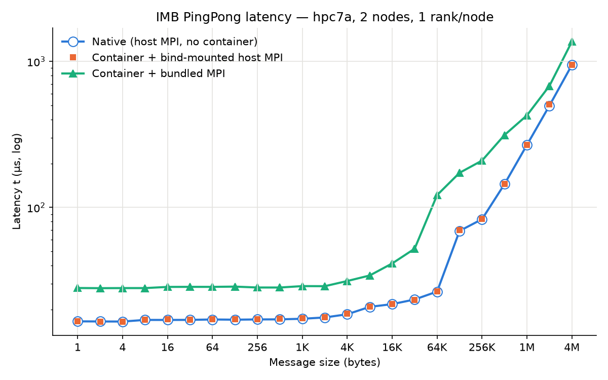
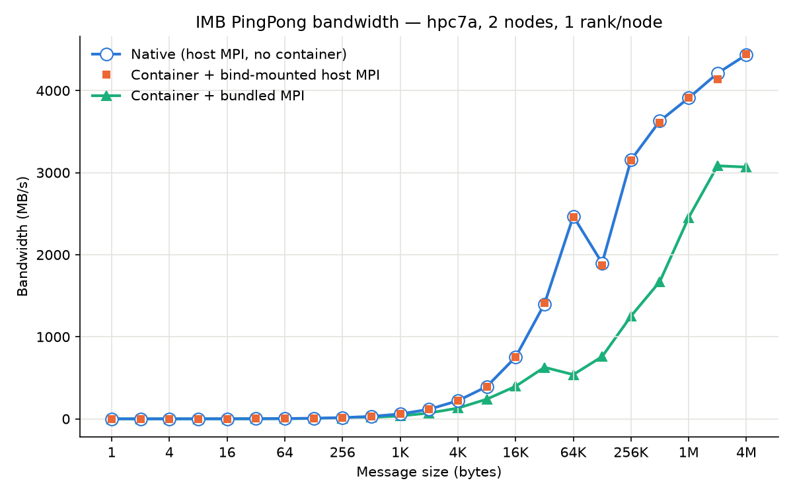

# Containerized Intel MPI Benchmarks

IMB-MPI1 **PingPong** results comparing three ways of running MPI on AWS **hpc7a** (AMD Zen 4):

| Run | Description |
|---|---|
| **Native** | Host MPI, no container (baseline) |
| **Container + bind-mounted host MPI** | Host MPI bind-mounted into the container, replacing the container's MPI. Requires ABI compatibility between the host MPI and the MPI the benchmark was built against. |
| **Container + bundled MPI** | MPI shipped inside the container image, not tuned for the host fabric |

Setup: 2 nodes (instances), 1 rank per node, each rank bound to 1 core.

## Results





| Metric | Native | Bind-mounted host MPI | Bundled MPI |
|---|---|---|---|
| 0-byte latency (µs) | 16.58 | 16.60 | 28.02 (+69%) |
| 64 KB latency (µs) | 26.54 | 26.66 | 121.58 (4.6x) |
| 4 MB bandwidth (MB/s) | 4436.72 | 4443.26 | 3067.87 (−31%) |

## Takeaways

- **Bind-mounting host MPI matches native performance.** Latency and bandwidth are within run-to-run noise at every message size, so the container itself adds no measurable overhead.
- **The container's bundled MPI is much slower.** It adds about 11 µs to small-message latency and peaks around 3.1 GB/s instead of 4.4 GB/s. The likely cause is that it is not built or tuned for the host interconnect.
- All three runs show a bandwidth dip at 128 KB. Because it appears in the native run too, it is MPI/fabric protocol behavior, not a container effect.

## Reproduce plots

Raw data lives in `data/*.csv`.

```sh
uv run --with matplotlib plot.py   # or: pip install matplotlib && python plot.py
```
